# FMB Vocal

**A physically simulated singing voice for the M-VAVE FM-1**: a simulated airway (lungs, vocal folds, throat, mouth
and nose), not samples.

> **Voice engine based on [CHIMERA](https://github.com/jamesondh/chimera-vocal-synth) by Jameson Hodge** (MIT
> licence). FMB Vocal is an independent firmware, not CHIMERA and not endorsed by its author. Built on
> [fm1-base](https://github.com/charlesvestal/fm1-base) by Charles Vestal.

FMB Vocal sings words: each key sings the next syllable of a line, at the key's pitch, through the engine's
text-to-speech front end. In VOWEL mode the keys play pitch and the knobs move the mouth through the vowels. It also
sings whole lines on built-in tunes (ENV). The same mouth beatboxes (SEQ), and LFO swaps it for a seal's, a
a cat's, a songbird's, a seal's, an alligator's or an elephant's (the Bestiary).

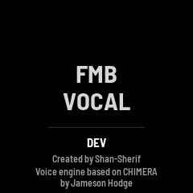
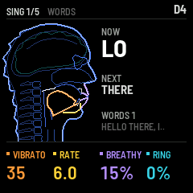

## The keys

- **WORDS** (the start, and HOME): each key sings the next syllable of the word slot: the consonants before the vowel
  when you press, the vowel for as long as you hold, the consonants after it when you let go. Press the next key
  before letting go of the last and the two syllables join (legato). Harder presses breathe harder. After the last
  syllable it starts again.
- **VOWEL** (FX): the keys play pitch only, the voice holding the vowel the knobs set; the last key held sounds, the
  pitch gliding (Glide) between keys.
- **In the beatbox** (SEQ) the keys are drum pads, the black keys a hummed bass ([below](#beatbox)); **in the
  Bestiary** (LFO) they play the creature's pitch ([below](#bestiary)). From 0.7.0.
- **Pressing harder** on a held key deepens its vibrato (up to 50 cents more), like a singer leaning into a long note.
  From 0.6.0.
- MIDI in plays as the keys do, and lights the keys its notes fall on ([below](#playing-from-a-midi-controller)).
- **OCT− / OCT+** move the keys an octave. About 50 ms after the sound dies away the
  voice rests (nothing is simulated, the output is silent).

## Playing from a MIDI controller

MIDI sent to the FM-1, from a computer over USB (a DAW, or a controller plugged into the computer) or from a
controller on the FM-1's TRS MIDI jack, plays the voice as the FM-1's own keys do, in WORDS and VOWEL mode, and lights the keys its notes fall on at the current octave. From 0.6.0
it also shapes the voice:

| Controller | What it does |
| --- | --- |
| Notes | Sing the next syllable (WORDS) or the held vowel (VOWEL), at the note's pitch and velocity |
| Aftertouch (channel or polyphonic) | Deepens the vibrato while a note is held, up to 50 cents more, as pressing harder on the FM-1's keys does |
| Mod wheel (CC1) | Adds breath: from the Breathy knob's setting (wheel down) up to fully breathy (wheel up) |
| Pitch bend | Bends the pitch up to ±2 semitones |

In the beatbox (SEQ) MIDI notes play the pads of the keys they fall on; in the Bestiary (LFO) they play the creature's
pitch, and pitch bend bends it.

The FM-1 itself has no mod wheel or pitch bend: these come from the controller. Every MIDI channel is listened to.
(Bluetooth MIDI, and a USB keyboard plugged straight into the FM-1, aren't built into this firmware.)

## The buttons

| Button | What it does |
| --- | --- |
| HOME | WORDS mode, page 1 (SING). |
| FX | VOWEL mode and back (a quick press). Held with a key 1-12: that vowel snapshot (below). Its light is on in VOWEL mode. |
| SEL | The next of pages 2-5, when released (in TONGUE mode: TONGUE, SHAPE, MOUTH). Held: PRESET and SELECT set the BLENDED body's gender and age ([below](#blending-the-bodies)). (Until 0.5.0 this was EDIT.) |
| ARP | TONGUE mode and back: the tongue placed by hand, the keys playing pitch ([below](#tongue)). Its light is on in TONGUE mode. From 1.0.0. |
| EDIT | Opens the word editor on the slot being sung: type words on the keys ([below](#typing-words)). (From 0.5.0; before, EDIT stepped the pages.) |
| PLAY | Speaks the word slot's words (in WORDS mode). Pressing a key while it speaks starts singing instead. |
| SAVE | Keeps the knobs in the voice preset, the vowel snapshots and the settings, through power-off. Its light is on while something is unsaved. |
| ENV | Sings the word slot on one of CHIMERA's tunes ([below](#tunes)). From 0.8.0. |
| SEQ | The beatbox: the keys become drum sounds, with a step sequencer ([below](#beatbox)). SEQ again: MELODY, your own melody sung ([below](#melody)); SEQ switches between them, HOME back to the words. |
| LFO | The Bestiary (the cat, the songbird, the seal, the alligator or the elephant) and back to the human voice ([below](#bestiary)). Its light is on in the Bestiary. From 0.7.0. |
| GLO | The debug page (the cores' timings) and back. From 0.8.0 it also opens over the beatbox and the SING page, to see their load while they play. |

## The knobs

**K1-K4** are the page's four values, shown at the bottom of the screen in their colours (K1 green, K2 red, K3 pink,
K4 white). **SELECT** turns the page. The ranges are CHIMERA's own. (In the beatbox they are its tempo, swing and step
cursor, in the Bestiary the creature's settings: see their sections.)

| Page | K1 | K2 | K3 | K4 |
| --- | --- | --- | --- | --- |
| 1 SING | Vibrato (cents, sung notes) | Rate (vibrato, Hz) | Breathy | Ring (the singer's ring, near 3 kHz) |
| 2 SHAPE | Jaw (opening, cm) | Lips (opening, cm) | Larynx (up / down, cm) | Palate (the soft palate: SHUT, or the nose's opening, cm²) |
| 3 MOUTH | Round (the lips' rounding) | Protrude (the lips, cm) | Root (the tongue root, cm) | Curl (the tongue tip's) |
| 4 SOURCE | Breath (the lungs' pressure, cmH₂O) | Pressed (the vocal folds) | Rough | Fry |
| 5 PLAY | Glide (pitch, ms) | Speed (PLAY's speech, ×) | F.Folds (the false folds) | Bright (the vocal folds' closure: darker ← → brighter) |
| VOWEL | Front (← front, back →: F2, Hz) | Open (close → open: F1, Hz) | Nasal (the soft palate) | Round |

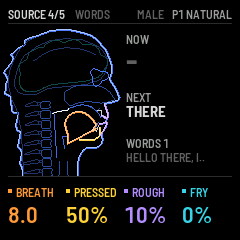

The shaping knobs (pages 2 and 3) set the voice's posture, as CHIMERA's do: they shape the held vowels and the voice
between words; while it sings words, the words' own movements lead.

**Bright** (page 5, K4) is how sharply the vocal folds close on each vibration, CHIMERA's own brightness. Low is soft
and dark, high is forward and edgy. The presets use it as part of their character.

## Body

**ALGORITHM** chooses the voice's body, on every page but the Bestiary's (there it chooses the creature): **MALE**, **FEMALE** or **CHILD**, CHIMERA's three bodies, or **BLENDED**, your own blend of them ([below](#blending-the-bodies)). The
body is the whole airway, its size, its throat's length, its tongue and lips, with each body's own calibrated vowels
and consonants, so a female or child voice is a different instrument, not a pitch shift. The screen names the body as
you turn, and it changes when the knob rests (the voice switches to the new body's anatomy, with a quick fade). The head on the
screen is drawn in the body's size, and the header shows the body beside the preset.

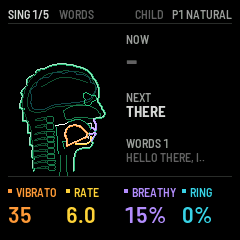

- **The keys still set the pitch.** Each body speaks (PLAY) at its own pitch: 112 Hz male, 205 Hz female, 250 Hz
  child. Move OCT− / OCT+ to where the body sounds best.
- **VOWEL mode follows the body:** Front and Open, and the twelve snapshots, reach the same vowels in every body, at
  that body's formants.
- **Presets keep their body:** SAVE stores it with the knobs, so a preset can be a child's or a female voice.

(From 0.5.0. Until then ALGORITHM was Bright, and page 5's K4 was Body, which only had the male.)

### Blending the bodies

From 1.0.0 a body can be anywhere between the three, as CHIMERA's two body sliders make it. From 1.1.0 that blend is
a body of its own: **ALGORITHM** turns through **MALE**, **FEMALE**, **CHILD** and **BLENDED**. **Hold SEL** and turn
to set BLENDED's blend:

- **PRESET: gender**, from male (0 %) to female (100 %).
- **SELECT: age**, from adult (0 %) to child (100 %).

Turned while a body whole is chosen, they switch to BLENDED starting from that body's place (from FEMALE: gender
100 %, age 0 %), so nothing jumps. BLENDED keeps its blend while ALGORITHM picks the others, so it is there again when
you come back to it; until you set one it is half male, half female.

CHIMERA has one child, not a boy and a girl, so the two make a triangle: the more child, the less gender matters (at
age 100 % it is the child whatever the gender). The shares are male (100 − age) × (100 − gender), female
(100 − age) × gender, child age; the screen shows them as you turn, and in the header after ("M 50  F 50"); the voice
switches when you let go of the knob, as ALGORITHM's does.

The blend is the airway's size, throat, tongue and lips between the bodies', each sound's calibrated targets blended
the same way (CHIMERA's own blending), the speaking pitch and the vowel pad's range between theirs. SEL released after
a turn keeps the page; SEL alone still turns it. A preset keeps its body, BLENDED included, and BLENDED's blend.
(Presets saved with 1.0.0 that held a blend come back as BLENDED; earlier ones keep their body.)

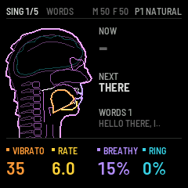

**VOWEL** is CHIMERA's vowel pad: Front and Open choose a place among the vowels (by their formants, F1 and F2), and
the voice blends the four calibrated vowels nearest it. The screen names the vowel made (in ARPAbet's letters: AA as
in "father", IY "see", UW "you", AE "cat", AX the neutral schwa).

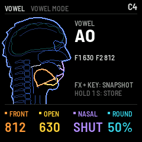

**Vowel snapshots:** hold FX and press one of the first twelve keys to jump to that vowel (they start as twelve
English vowels: IY IH EY EH AE AA AO OW UH UW AH AX). Hold the key a second, with FX, to store the vowel you have
made there instead. SAVE keeps them.

## Tongue

**ARP** (from 1.0.0) is CHIMERA's Play mode on the knobs: the tongue placed by hand rather than through the vowels.
The keys play pitch, the breath on while one is held, as in VOWEL mode; the knobs move the tongue:

| Page | K1 | K2 | K3 | K4 |
| --- | --- | --- | --- | --- |
| TONGUE | Forward (the tongue body, back ↔ front, cm) | Height (low ↔ high) | Tip fwd (the tip, back ↔ forward) | Tip up (low ↔ up to the ridge) |

Unlike the vowel pad, this reaches shapes that are not vowels: the tip raised to the ridge behind the teeth closes the
mouth there (a held note goes quiet, as in a /t/), the tongue's back raised to the palate closes it further back (/k/).
The anatomy keeps the tongue out of the palate, as CHIMERA's does when you drag it. The screen names the vowel nearest
the shape.

**SEL** steps TONGUE, SHAPE (jaw, lips, larynx, soft palate) and MOUTH (rounding, protrusion, tongue root, tip curl):
with those, every part CHIMERA's head lets you drag. SELECT turns through those and the voice's pages. **FX** goes to
VOWEL mode, **ARP** or **HOME** back to WORDS (the tip resting behind the teeth again).

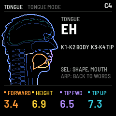

## Presets and word slots

- **PRESET** chooses one of eight voice presets, loaded when the knob rests: NATURAL, BREATHY, BELT, OPERA, AIRY,
  ROUGH, FRY, TWANG (this port's own: CHIMERA has none). SAVE stores the knobs as they are into the preset chosen.
- **HOME + PRESET** (turn PRESET with HOME held) chooses the word slot the keys sing, 1-8, as the Studio sent them
  or as you typed them. The screen shows the slot and how it starts.
- In the beatbox PRESET chooses the beat, in the Bestiary the creature's call (from 0.7.0), on the SING page the
  tune (from 0.8.0).

## Tunes

**ENV** opens the SING page (from 0.8.0): the FM-1 sings the word slot by itself, on one of CHIMERA's tunes, the way
CHIMERA's Sing button does. Your words are cut into lines and each line fitted to a phrase of the tune: more syllables
than notes split the longest notes, fewer stretch a syllable over several (its vowel carried from one pitch to the
next). Each phrase is sung on its own breath.

- **PLAY** sings, and PLAY again stops. With an empty slot it sings "la" on every note.
- **PRESET** chooses the tune: DREAMY (minor, unhurried), JOYFUL (major, bright), SOMBER (minor, slow), PLAYFUL
  (quick short notes, room for many words), GENTLE (a slow waltz), TWINKLE (the traditional tune); then your own
  melodies from the [MELODY page](#melody), MELODY 1 to 4 (an empty one is passed over). A melody is sung as you
  wrote it, a syllable a note and its rests breaths, at its own tempo times K1 and its own key plus K2; it keeps its
  octave whatever the body.
- **K1** tempo (×0.5 to ×1.5), **K2** key (±12 semitones), **K3** vibrato (cents), **K4** the word slot.
- **ALGORITHM** chooses the body: each sings the tune in its own octave (the male an octave down). The voice preset's
  sound (breathy, pressed, bright...) carries over.
- **SAVE** keeps the tune, tempo, key and vibrato. **ENV** or **HOME** leaves.

The screen shows the head singing, the syllable sounding, and the phrase's melody: each note a bar at its pitch, as
long as its beats, the one sounding lit.

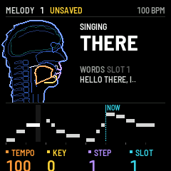

## Beatbox

**SEQ** turns the FM-1 into CHIMERA's beatboxer (from 0.7.0). Every drum is the same simulated mouth making a real
beatboxer's sound, the way beatboxers make it, so the head on the screen shows each one being made:

| Pad | Sound | How the mouth makes it |
| --- | --- | --- |
| 1st white key | Kick (`B`) | The lips shut, the glottis seals and the larynx rises like a piston, then the lips burst (an ejective) |
| 2nd | Snare (`Pf`) | The lips burst, then the lower lip hisses against the teeth |
| 3rd | Hi-hat (`t`) | The tongue tip releases into a short hiss |
| 4th | Open hat (`tss`) | The hi-hat left ringing as a long hiss |
| 5th | Rimshot (`K`) | The back of the tongue bursts on air the rising larynx compresses |
| 6th | Inward snare (`^K`) | A sharp breath in past the back of the tongue |
| 7th | Tongue click (`!`) | The tongue seals a pocket against the palate, hollows it and pops |
| 8th | Lip pop (`P!`) | The lips sealed, the jaw drops, the lips pop open |
| 9th | Crash (`kch`) | The back of the tongue releases into a long rounded hiss |
| Black keys | Hum (`m`) | A hummed bass through the nose, an octave below the key |

The next seven white keys repeat the first seven. A pad sounds as soon as the mouth can make it, about a tenth of a
second after the press: the mouth has to get ready (a click's pocket takes longest).

- **PLAY** starts and stops the beat. **PRESET** chooses one of eight beats: CHIMERA's seven (BOOTS AND CATS, FOUR ON
  THE FLOOR, BREAKBEAT, RIMSHOT SHUFFLE, INWARD SNARE, CLICKS AND POPS, HUM BASS) and MY BEAT, empty to start.
- **K1** is the tempo (40-200 BPM) and **K2** the swing (the off-beats late, up to 60 %).
- **ALGORITHM** still chooses the body: a child can beatbox too.
- **EDIT** writes steps (STEP EDIT): the cursor is outlined on the grid, **K3** moves it, and a pad writes its sound
  into the step and moves on (hold **FX** for an accented, louder step, marked with a dot). **OCT−** clears the step
  and goes back, **OCT+** clears it and goes on. Edits are heard at once if the beat is playing. EDIT again: the pads
  only play.
- **SAVE** keeps every beat, its tempo and its swing through power-off. **HOME** leaves; **SEQ** switches to
  [MELODY](#melody) and back.

The grid shows the beat's sixteen steps in two rows, each sound's symbol in its colour (kicks green, snares red, hats
pink, clicks and pops white, the hum blue), the step playing lit.

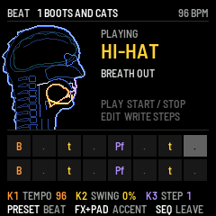
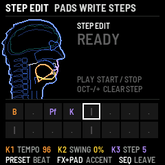

The beatbox plays through CHIMERA's close-mic sound (a microphone's bass boost up close, a little presence, a fast
compressor), as CHIMERA's does.

## Melody

**SEQ** twice opens the **MELODY** page: the beatbox first, then, with SEQ again, your own melody, which the voice
sings. SEQ switches between the two; **HOME** goes back to the words from either.

A melody is **32 steps**, each an eighth note (four bars of 4/4). A step holds a **note**, a **rest** or a **tie**
(the note before it held on). **PLAY** sings the word slot on it: a syllable a note, a tie holding the vowel, a rest a
breath. When the words have more syllables than the melody has notes, the melody plays again until every one is
sung (the words start again to finish its last time); with no words it sings "la". PLAY again stops.

- **EDIT** turns step editing on and off. While it is on, a **key** writes its note at the cursor and moves on,
  **OCT−** writes a rest and **OCT+** a tie. **K3** moves the cursor.
- With step editing off and the melody stopped, the keys sing as in WORDS (a note to try first).
- **PRESET** chooses one of four melodies (the first two written, the others empty). **K1** is the tempo (40-200 BPM),
  **K2** the key (±12 semitones), **K3** the step, **K4** the word slot; **ALGORITHM** the body.
- **SAVE** keeps the melodies.

The screen shows the head singing and the syllable now, then the melody's 32 steps, each note a bar at its pitch as
long as its ties, the step singing lit and, while editing, the cursor outlined. A dashed cyan line (the colour of
SLOT, K4) stands before each note where the words start again from the slot's first syllable: with 10 syllables on
a 14-note melody, before its 11th note. When the words are longer than the melody, it plays more than once and the
lines for every time through show on the same 32 steps, each labelled with the time through it falls in: stopped,
**1ST**, **2ND**, **3RD**...; while it sings, **NOW** (this time through, bright), **NEXT** (the next one, dim) and
the later ones by number, the ones already sung gone. With 4 notes and 10 syllables, for example, the words start
again on the 3rd note the 3rd time through.

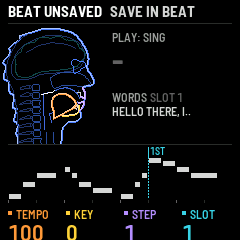
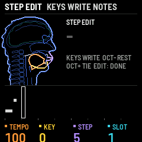

## Bestiary

**LFO** swaps the human voice for an animal's, and **LFO** again goes back to the human body ALGORITHM holds. On the
Bestiary page **ALGORITHM** chooses the creature, in this order: the **cat** (FMB Vocal's own, where the Bestiary
opens), then the **songbird**, the **seal**, the **alligator** and the **elephant** (CHIMERA's Bestiary). Each one is simulated the way the human voice
is, from its own airway and its own sound source.

On every creature:

- **The keys** play its pitch: it breathes while a key is held, the last key held sounding. The keys are shifted by
  whole octaves to sit in the creature's range (CHIMERA's mapping, centred on middle C): one octave up for the cat,
  three up for the songbird, one up for the seal, three down for the alligator, four down for the elephant.
- **PRESET** chooses one of its calls. **PLAY** plays it; **FX + a key** plays it at the key's pitch.
- **K1-K4** are its settings, on two pages (**SEL**).
- **SAVE** keeps each creature's settings and call. The beatbox needs a human body: LFO back first.

The screen draws the animal side on, traced in its own colour, with its airway inside: the lungs, the glottis, the
throat, the mouth (or beak) and the nose (or trunk), the breath lighting them as it flows. The mouth or beak opens
as its setting does, the nose lights as NOSE opens it, and the songbird's two valves and the elephant's lips light
as they open.

### The cat

A **cat**, FMB Vocal's own creature (CHIMERA's Bestiary has none): a small larynx, a 3.5 cm throat, a 5.5 cm mouth and
a short nose behind the soft palate. Its range is 120 Hz to 1.6 kHz; a meow sits around 400-900 Hz. MOUTH shapes the
sound as a cat's jaw does ("mi-a-ow" is the mouth opening and closing), NOSE lets it out through the nose (with the
mouth shut, a hum). **PURR** pulses the voice at RATE (about 26 times a second, as a cat's larynx twitches) and takes
it down toward a low buzz; **HISS** parts the vocal folds and hisses air at the teeth.

| Page | K1 | K2 | K3 | K4 |
| --- | --- | --- | --- | --- |
| 1 VOICE | Mouth (its opening) | Breath (the lungs' pressure, cmH₂O) | Nose (the passage behind the soft palate) | Rough (chaotic vibration) |
| 2 PURR | Purr (how much the voice pulses) | Rate (the pulses, Hz) | Hiss (the folds apart: air alone) | |

Its calls: MEOW (the mouth opening as the pitch rises, closing as it falls), PURR (four seconds, through the nose,
breathing out and in), HISS (the mouth open, air at the teeth), TRILL (a short, rising, rolled chirrup), YOWL (long,
low and slow).

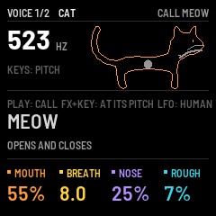

(Its airway is the shortest in the Bestiary, so it runs at the full rate and costs core 2 less than the seal.)

### The songbird

A thrush-sized **songbird** with two voices: its syrinx has two pairs of labia, one in each bronchus, each with its own
pitch. Both feed the trachea, then a throat cavity that can follow the note (a pure, whistled tone), then the beak.
Its range is 400 Hz to 9 kHz. The diagram lights each voice's valve as it opens.

| Page | K1 | K2 | K3 | K4 |
| --- | --- | --- | --- | --- |
| 1 SYRINX | Interval (the second voice, semitones from the first) | Voices (left alone ← both → right alone) | Drive (pure ↔ raspy) | Tension (the labia's) |
| 2 THROAT | Breath (the air sacs' pressure, kPa) | Purity (how far the throat follows the note) | Throat (the cavity's size when it doesn't, cm³) | Gape (the beak's opening) |

Its calls: FLUTE (three notes, then a two-voice shimmer, a wood thrush's), TRILL (a canary's, 16 upsweeps a second),
CHIRPS (falling, faster and faster), BUZZ (a zebra finch's, raspy, pulsed by mini-breaths).

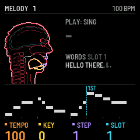

(CHIMERA simulates the songbird four times faster than the FM-1's sound runs. On the FM-1 it is a lighter airway at
twice the rate, with the syrinx's cycles precomputed from CHIMERA's own equations; its level and harmonics are within
a few dB of CHIMERA's.)

### The seal

The **Weddell seal**, whose calls glide down over seconds while their pulses slow (researchers compare them to
analogue synths). Its larynx, throat and mouth, its breath pulsing. Its range is 40 Hz to 6 kHz.

| Page | K1 | K2 | K3 | K4 |
| --- | --- | --- | --- | --- |
| 1 PULSE | Rate (the pulses, Hz) | Depth (how much they pulse) | Duty (how long each pulse lasts) | Bright (the larynx's closure) |
| 2 VOICE | Rough (chaotic vibration) | Breath (the lungs' pressure, cmH₂O) | Mouth (its opening) | |

Its calls: TRILL (falling for 3.6 s, its pulses slowing), ZAP (a laser chirp), WHISTLE (dips and returns), CHUG (a
low pulsed grunt).

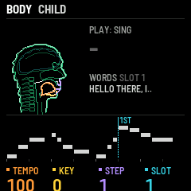

### The alligator

The **American alligator** (from 0.9.0): a chaotic, very low roar from its larynx through a long throat and a mouth
held nearly shut, so the sound leaves by the nostrils and the body itself. Its range is 12 to 120 Hz, much of it below
what the FM-1's speaker plays: its roughness and its upper harmonics carry it there, headphones or a speaker with bass
the rest.

| Page | K1 | K2 | K3 | K4 |
| --- | --- | --- | --- | --- |
| 1 ROAR | Chaos (period doubling into chaos) | Breath (the lungs' pressure, cmH₂O) | Hiss (the glottis open: air alone) | |
| 2 AIRWAY | Mouth (its opening) | Nose (the passage to the nostrils) | | |

Its calls: BELLOW (two seconds of roar, rising into full chaos), GROWL (a short, rough warning), HISS (the mouth and
glottis open: pure turbulence), DANCE (a steady subsonic throb, the one that makes the water dance on its back).

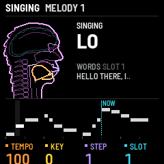

### The elephant

The **African elephant** (from 0.9.0): rumbles from huge vocal folds, routed through a 1.85 m trunk or the mouth, and
trumpets from a valve at the trunk's base that buzzes like a brass player's lips and locks onto the trunk's
resonances. TRUMPET (K1) moves from the rumble (the folds vibrate, the valve open) to the trumpet (the folds open,
the lips buzz); LIPS sets the lips' own pitch, and the trunk pulls the note to its nearest resonance. While it
trumpets the screen shows the lips' pitch, and their valve lights as they open. The rumble's pitch (8 to 45 Hz, the
keys) is mostly below hearing: you hear its harmonics.

| Page | K1 | K2 | K3 | K4 |
| --- | --- | --- | --- | --- |
| 1 VOICE | Trumpet (rumble ↔ trumpet) | Lips (the valve's pitch, Hz) | Breath (the lungs' pressure, cmH₂O) | Chaos (in the folds) |
| 2 AIRWAY | Trunk (the air through the mouth ↔ the trunk) | | | |

Its calls: RUMBLE (three seconds of infrasound through the trunk), TRUMPET (a brassy blast that bends up and breaks
into chaos), SQUEAK (the lips tensed, high).

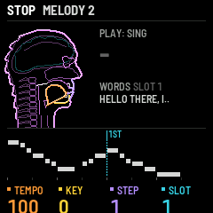

(Both are longer airways than the human's: the alligator's 68 cm, the elephant's 2.6 m with its trunk. Their sound is
low, so on the FM-1 each is simulated at half the rate and smoothed back up: measured on the FM-1, the elephant's
trumpet peaks at 64 % of core 2 and the alligator's bellow at 30 %. Their levels are within a few dB of CHIMERA's.)

## Typing words

From 0.5.0 you can write the word slots on the FM-1 itself, without the Studio. **EDIT** opens the editor on the slot
the keys are singing.

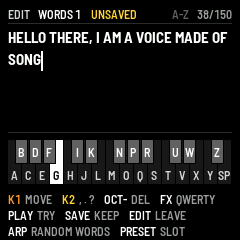

- **The keys type, a letter each**, in one of two layouts. **FX** switches between them, and the FM-1 remembers
  your choice. The screen's keyboard shows each key's letter and lights the key you hold. The keys don't sing while
  the editor is open; MIDI in still does.
  - **A-Z** (the first): the 26 lowest keys are A to Z from the bottom up, black keys included, and the top key (G5)
    is a space.
  - **QWERTY** in two rows: the black keys are a keyboard's top row, Q W E R T Y U I O P, with the last black key
    a space. The white keys are A S D F G H J K L, then Z X C V B N M. The first key of each row (Q, A and Z) and
    the space glow softly, and are green on the screen's keyboard, so you can find the rows.

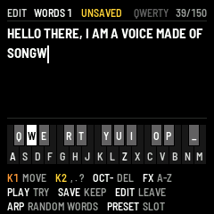

The bottom of the screen lists the editor's controls, so you don't need to remember them:

- **K1** moves the cursor. **K2** changes the character before the cursor, through A-Z, space and the punctuation
  `, . ? ! ' -`. Commas and full stops give the voice its pauses, as in the Studio.
- **OCT−** deletes the character before the cursor (hold it to keep deleting), **OCT+** the one after it.
- **ARP** fills the slot with a random line of words (3 to 6, from the FM-1's built-in words, which it always
  pronounces well); press it again for another. As any edit, it's kept only if you SAVE. From 0.6.0.
- **PLAY** speaks the words as they are typed, to try them.
- **SAVE** keeps them in the slot, through power-off, and leaves; the keys then sing them. Saving an empty slot
  removes it.
- **EDIT** or **HOME** leaves. If something is unsaved, the first press warns (UNSAVED) and a second press drops the
  changes.
- **PRESET** chooses another slot to edit, empty ones included (with nothing unsaved).

A slot holds up to 150 characters. The words you type are pronounced by the FM-1's built-in word list (about 480
common words) and its spelling rules; the Studio can give any word its dictionary pronunciation. The Studio reads the
slots back when it connects, so words typed on the FM-1 show up there too. Each of the Studio's slots has a
**Random** button as well, drawing from about 8,600 everyday English words (from 0.6.0).

## What the screen shows

At the top: the page (SING 1/5 ... or VOWEL), the mode, the body and the preset; the note while one sounds. The head, side on,
moving as it sings, in its body's colour (male blue, female red, child green, a blend mixed by its shares): the
tongue orange, the jaw yellow, the lips violet, the soft palate white. Its brain shows the FM-1's two processor cores
at work: its colour the second core's load (the airway: cyan when idle, through green and yellow, to red at 85 %, the
most the voice should use), its brightness the first core's (the control). They are read every half second, as the
debug page's CORE 2 and CORE 1 lines. Beside it in WORDS: NOW, the
syllable sounding (a hyphen when its word goes on; SPEAKING while PLAY speaks), NEXT, the one the next key sings, and
the word slot; in VOWEL: the vowel made and its formants. At the bottom: the page's four knobs.

**SEQ** shows the beatbox's page instead (the head as it beatboxes, the sound heard, the sixteen steps), **LFO** the
Bestiary's (the creature's pitch, the animal and its airway, its call): see their sections.

**GLO** switches to the debug page and back: how long each core takes.

| Line | What it means |
| --- | --- |
| CORE 2 TRACT | The second core's share of each audio block (5.8 ms): the sound waves through the throat, mouth and nose, and the vocal folds, every sample. The average over the last half second, then the worst block. With the songbird all of it runs here (about 44 % at its worst), and CORE 1 shows 0. The elephant peaks at about 64 %, the alligator 30 %. |
| CORE 1 CONTROL | The first core's share: moving the articulators along the gestures, then turning the tongue, jaw and lip positions into the shape of the tract. |
| AUDIO LOAD | The whole audio interrupt's share of its time. |
| XRUNS | Blocks that were late since power-on: each is a click. It should stay at 0. |
| TWO CORES / ONE CORE | Whether the second core is running. If it fails, the voice continues on one core. |

Anything under 100 % fits. The anatomy (the tongue, jaw and lip positions turned into the tract's shape) runs every
4th control step (every 5.8 ms), the tract gliding between. On the debug page **K1** tries it every 8th step (lighter
on core 1, the tongue and lips a little less exact) or every 2nd (back to every 4th at power-off): every 2nd peaks
near 100 % of core 1 while it speaks, and the difference is hard to hear. Every step is not offered: it overloads
core 1.

**K2** on the debug page (from 0.8.0, off again at power-off) turns on a treble shelf: the voice 7 dB quieter above
about 2.5 kHz. Measured against CHIMERA's renders, the FM-1's voice is 3-9 dB brighter up there; the shelf brings it
about twice as close, but it also dulls the snare and the crash. It is there to listen to, before deciding whether it
should stay. The debug page's K1 and K2 work over the beatbox and the SING page too.

## The Studio: your words

Open the site's **Studio** page in Chrome or Edge. On the left is an emulated FM-1 (the same firmware, in the
browser): press its **START**, then **Play** on a slot speaks that line there, and the emulator's keys sing it. On the
right are the eight slots, starting with CHIMERA's presets; each shows its syllables (one key each) and every word's
pronunciation from the CMU Pronouncing Dictionary. A word it does not know (a name, a made-up word) gets a box: say how
it sounds with words it knows ("sheh vawn" for Siobhan).

With your FM-1 on USB, **Connect** loads the slots it holds. **Send to FM-1** on a slot puts that line on it (its other
slots stay); **Update all slots** sends all eight. The FM-1 says "WORDS RECEIVED", keeps them through power-off and
sings the slot. A slot's badge says whether your FM-1 has it as shown. **Read from FM-1** brings back what it holds;
**Save file** / **Load file** keep sets of words on the computer.

## How the words are read

CHIMERA reads English with the CMU Pronouncing Dictionary (134,000 words), which does not fit in the FM-1. The
firmware knows the pronunciations of about 480 common words; others are read by spelling rules: CHIMERA's, plus a few
of this port's for doubled letters, plural and past-tense endings and the like. The rules get most words close but not
all exact, so an unusual word can come out oddly. Words sent from the Studio come with the dictionary's pronunciations,
so those are exact.
