# FMB Vocal

**A physically simulated singing voice for the M-VAVE FM-1.** Lungs, vocal folds, throat, mouth and nose, simulated:
an airway that sings, played from the keys and the knobs. A variation of
[FM-1 Chimera Vocal](https://github.com/shan-sherif/fm-1-chimera-vocal), with its own look and features.

> **Voice engine based on [CHIMERA](https://github.com/jamesondh/chimera-vocal-synth) by Jameson Hodge** (MIT
> licence). FMB Vocal is an independent firmware, not CHIMERA and not endorsed by its author. It's built on
> [fm1-base](https://github.com/charlesvestal/fm1-base) by Charles Vestal and
> [felucca-bsp](https://github.com/hugelton/felucca-bsp) by Leo Kuroshita, Hügelton Instruments.

This is version {{VERSION}} of FMB Vocal. The FM-1 sings words: each key sings the next syllable of a line, at the
key's pitch, and PLAY speaks the line. ALGORITHM chooses a male, female or child body, each with its own airway and its
own vowels, and SEL held with PRESET and SELECT blends them (gender and age). ARP places the tongue by hand. Every
sound comes from the simulated airway, not from samples. It sings whole lines by itself on built-in tunes (ENV), or on melodies you write
with the keys (SEQ twice: MELODY). The
same mouth beatboxes (SEQ: ten drum sounds, preset beats and a step sequencer), and LFO swaps it for a cat's, a
songbird's, a seal's, an alligator's, an elephant's or a robot's (dubstep).

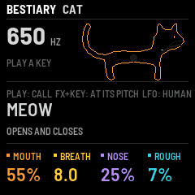
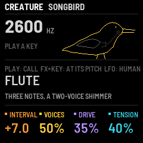
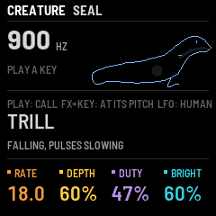
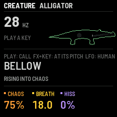
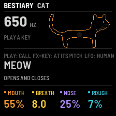
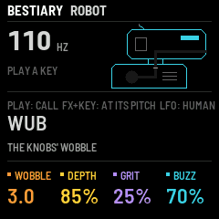
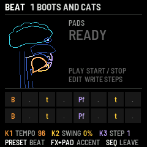
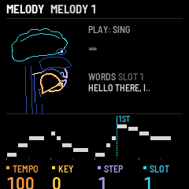
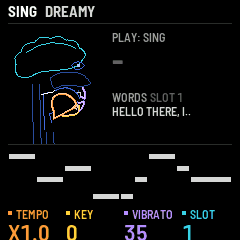
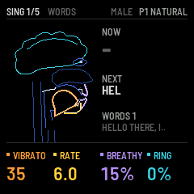
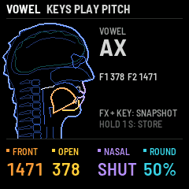

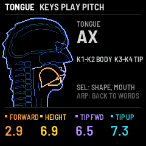

The voice uses both of the FM-1's processor cores: the second core simulates the sound waves in the throat, mouth and
nose and the vocal folds, every sample; the first runs the control (the tongue, jaw and lips moving along the
words' gestures, and the anatomy that turns them into the tract's shape) and the screen. CHIMERA's full airflow
simulation, which the engine comes from, is about twice what the FM-1 can run, so the tract is a lighter waveguide driven by the engine's anatomy,
vocal folds and noise sources.

You install it at your own risk, and the installer can put M-VAVE's own firmware back.

It works with both FM-1 flash chips, the older Puya P25Q80 (`0x856014`) and the newer UC25HQ80 (`0xB36014`): the
same fix as [Felucca's](https://github.com/hugelton/Felucca/commit/f4cbb6a2a0a35e068d4f063083d464eb4dbaa415)
([#320](https://github.com/hugelton/Felucca/issues/320)) and
[SLOOP's](https://github.com/isod89/sloop-fm1/commit/bac9c05ea7627449405aa10e48da21d75b6c8c56), here from fm1-base
(Laurens, PR #35). Not yet tested with this firmware on a newer unit.

- The [Studio](studio/) prepares the words the FM-1 sings, with the CMU Pronouncing Dictionary, lets you try them on
  an emulated FM-1 in the browser, and sends them to yours over USB. You can also type them on the FM-1 itself: EDIT
  opens the word editor, a letter a key.
- [Install](install/) it from Chrome or Edge, with the FM-1 connected by USB.
- The [Manual](manual/) explains the keys, the knobs and the screen.
- The [Source](https://github.com/shan-sherif/fm-1-fmb-vocal): the voice's port is MIT (CHIMERA's licence), the
  firmware's platform MPL-2.0 (fm1-base's).

These pages count visits with [GoatCounter](https://www.goatcounter.com/): no cookies, no personal data.

Unofficial: not affiliated with or endorsed by M-VAVE, Jameson Hodge or fm1-base's authors. M-VAVE and FM-1 are
trademarks of their owners.
